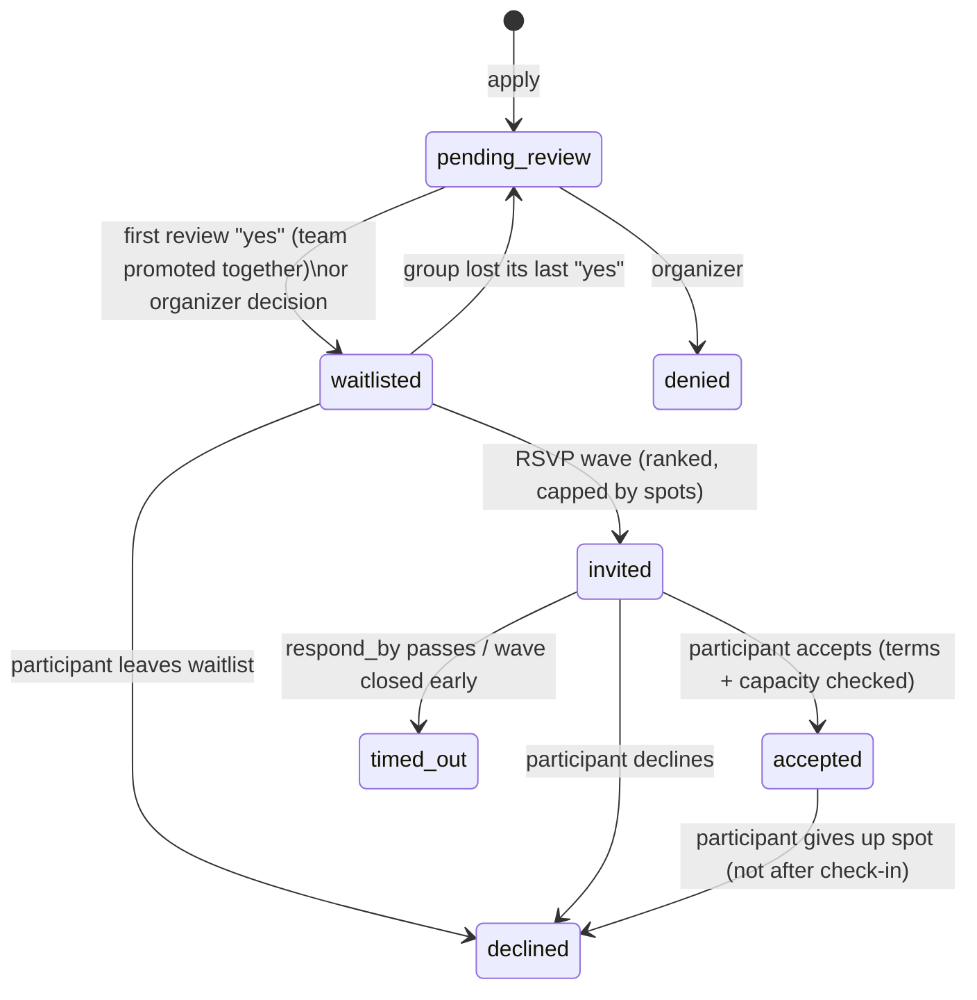

# RSVP System Spec

How an applicant gets from "accepted application" to "holding a spot", and how organizers drive that. This describes the system as built. The code is the source of truth, and each section names the files it comes from.

- Domain module: `src/lib/rsvp/` (import as `Rsvp` from `@/lib/rsvp` or `@/lib/rsvp/server`)
- Status rules: `src/lib/participation/status.ts`, `src/lib/participation/transitions.ts`
- Waitlist ranking: `src/lib/application-vote-ranking.ts` (pure), `src/lib/rsvp/waitlist.ts` (DB)
- Participant actions: `src/app/dashboard/events/actions.ts` (`submitRsvpResponse`, `withdrawParticipation`)
- Admin actions: `src/app/dashboard/admin/events/actions.ts` (`sendEventRsvpWave`, `updateParticipantStatus`, `resendRsvpInvitation`, `getEventRsvpSummary`)
- Queue consumer: `src/app/api/queues/rsvp-invitation/route.ts`
- Scheduler: `workers/rsvp-cron` (Cloudflare) → `src/app/api/cron/hourly/route.ts`

---

## 1. Concepts

| Term | Meaning |
| --- | --- |
| **Participant** | One `event_participants` row per (event, user). It holds the participant's **single status** for the whole lifecycle: review, RSVP and attendance. |
| **Waitlist** | Every participant with status `waitlisted`. This is the RSVP queue. Its **order is never stored**. It is derived from review votes on every read. |
| **Wave** | One `event_rsvp_waves` row: a numbered batch of invitations (1, 2, 3, …) for an event that share one deadline, `respond_by`. |
| **Invitation** | One `event_invitations` row per invited participant. It records the wave, the response time, Event Terms consent and the invitation email's delivery state. **It has no status column.** The RSVP outcome is the participant's status. |
| **Response window** | `events.rsvp_response_window_hours` (default 48). A wave's `respond_by = created_at + window`. Changing the window only affects waves created later. |
| **Capacity** | `events.capacity` (null = unlimited). Only `accepted` participants count against it. |

RSVPs only apply to events with `has_application = true`. Events without an application use plain registration instead (`unregisterFromEvent`, etc.).

---

## 2. Data model

`src/db/events-and-participation.ts`

```
events
  capacity                      int, nullable (null = unlimited)
  rsvp_response_window_hours    int, not null, default 48
  starts_at / ends_at           timestamptz
  terms_id                      → event_terms (current Event Terms version, nullable)

event_participants
  id, event_id, user_id
  status_id                     → participation_statuses (label is the status)
  reviewed_at, reviewed_by
  created_at                    application time, the final tie-breaker in ranking

event_rsvp_waves
  id, event_id
  wave                          smallint; UNIQUE (event_id, wave)
  respond_by                    timestamptz, the deadline for every invitation in the wave
  created_at

event_invitations
  id
  rsvp_wave_id                  → event_rsvp_waves (cascade)
  participant_id                → event_participants (cascade); UNIQUE, so one invitation per participant ever
  responded_at                  set on accept/decline/withdraw
  terms_accepted_at             set on accept when the event has terms
  accepted_terms_id             → event_terms, the exact immutable version agreed to
  invitation_email_status       'legacy' | 'unsent' | 'queued' | 'sent' | 'failed'
  invitation_email_attempts     smallint
  invitation_email_last_error   text
  invitation_email_queued_at    timestamptz
  invitation_email_sent_at      timestamptz
```

All timestamps are `timestamptz`. All deadline logic compares UTC instants.

---

## 3. Participation statuses

Defined in `src/lib/participation/status.ts`.

| Group | Status | Meaning |
| --- | --- | --- |
| Review | `pending_review` | Applied, not yet decided. Application answers are editable only here. |
| Review | `waitlisted` | Accepted application, in the RSVP queue. **The only status a wave draws from** (`WAVE_ELIGIBLE_STATUSES`). |
| Review | `denied` | Rejected. |
| Invitation | `invited` | Holds an open invitation. |
| Invitation | `accepted` | Holds a spot. This is the only "attending" status (`isAttending`): it counts against capacity, gets a wallet pass and can be checked in. |
| Invitation | `declined` | Declined the invitation, gave up a spot, or left the waitlist. |
| Invitation | `timed_out` | Did not answer before `respond_by`. |

### 3.1 Effective vs stored status

A stored `invited` whose wave's `respond_by` is in the past **reads as `timed_out`** everywhere (`resolveEffectiveStatus(label, respondBy, now)`). Every read path and business rule uses the effective status, so correctness never depends on a background job having run. `timeoutExpiredInvitations` only persists what reads already show.

### 3.2 Lifecycle



Organizers can override any status to any other status (§8.2).

### 3.3 What a participant may do themselves

`PARTICIPANT_TRANSITIONS` in `transitions.ts`:

| From | To | Action |
| --- | --- | --- |
| `invited` | `accepted`, `declined` | `submitRsvpResponse` |
| `accepted` | `declined` | `withdrawParticipation` (give up spot) |
| `waitlisted` | `declined` | `withdrawParticipation` (leave waitlist) |

---

## 4. The waitlist

`src/lib/rsvp/waitlist.ts` and `src/lib/application-vote-ranking.ts`

### 4.1 Getting onto it

Reviewers with `application:vote:all` vote yes or no on the swipe-review page. After each vote, `syncWaitlist(tx, eventId)` runs inside the voting transaction, which holds the event row lock. It applies `planReviewTransitions`:

- Applicants are grouped by **team**. A solo applicant is a group of one. Members with status `denied` are ignored: their votes don't count, and they are never promoted.
- A group **qualifies** once any counted member has at least one yes.
- Every `pending_review` member of a qualifying group is **promoted** to `waitlisted`, so a team is pulled in by its members' yeses.
- **Demotion** only happens for the group named by `demoteGroupOf`, which is the group whose vote was just undone or flipped. If that group no longer qualifies, its `waitlisted` members go back to `pending_review`. Demotion is never inferred otherwise, so someone an organizer waitlisted by hand stays waitlisted.

`syncWaitlistForEvent` (which takes the event lock itself) re-runs the sync after inputs change without a vote: team join or leave (`team-actions.ts`) and admin status changes.

### 4.2 Queue order

`orderWaitlist` sorts `waitlisted` participants by:

1. **Group score**: the Wilson lower bound (95%) of the yes share of the group's best non-denied member. 9/10 outranks 1/1. Ties go to more yes votes.
2. Groups with **no votes at all** (waitlisted by hand) rank after every scored group.
3. The group's earliest application (`anchor`).
4. The participant's own application order.

`getEligibleRsvpApplicants` attaches a 1-based `rank` from this order. `selectRsvpWaveInvitees` sorts by `rank`, then `applicationCreatedAt`, then `participantId` for a deterministic tie-break.

Because the order is derived from the same tally on every read, the waitlist an organizer sees and the order the next wave invites in always agree.

---

## 5. Waves

### 5.1 Sending a wave: `sendRsvpWave(eventId, { now?, closeActiveWave? })`

`src/lib/rsvp/send-rsvp-wave.ts`. The manual admin button and the hourly scheduler both use it.

**Pre-checks** (no lock held):

1. Event exists.
2. Event has not started (`now < starts_at`). Otherwise `WAVE_EVENT_STARTED_MESSAGE`.
3. `rsvp_response_window_hours` is an integer ≥ 1.
4. Persist timeouts for this event (`timeoutExpiredInvitations({ eventId })`).
5. If the latest wave is still open (`respond_by > now`) and `closeActiveWave` is not set, refuse with `WAVE_ALREADY_ACTIVE_MESSAGE`.
6. Compute eligibility: `availableSpots = max(0, capacity − count(accepted))`, or null if capacity is unlimited.
   - `availableSpots === 0` → "No available spots remaining for this event."
   - No `waitlisted` participants → "No eligible applicants for the next RSVP wave."
7. Invitees = `selectRsvpWaveInvitees(applicants, availableSpots)`: the top `min(eligible, availableSpots)` of the waitlist, or everyone when capacity is unlimited.

**Transaction:**

1. `SELECT … FROM events FOR UPDATE`. This is **the event lock**. Every RSVP mutation takes it first (wave send, `submitRsvpResponse`, `updateParticipantStatus` → `invited`, voting and waitlist sync), always in the order event, then participant.
2. Re-check that the event has not started, and re-read the latest wave under the lock.
3. If the latest wave is open:
   - Without `closeActiveWave`: refuse.
   - With `closeActiveWave`: set that wave's `respond_by = now` and compare-and-set all of its `invited` participants to `timed_out`. Report `{ wave, timedOutCount }`.
4. Insert the wave with number `latest + 1`, `respond_by = now + window` and `created_at = now`.
5. **Compare-and-set** the invitees from `waitlisted` to `invited`. Anyone whose status changed since eligibility was read (for example a reviewer moved them) is skipped, not invited out from under that decision. If nobody moved, the send aborts.
6. Insert one `event_invitations` row per moved participant (`invitation_email_status = 'unsent'`).

**After commit (best effort):**

- Publish one queue message per invitation **concurrently** (`Promise.allSettled`). After a successful publish, set `invitation_email_status = 'queued'` **only if it is still `'unsent'`**, so it never regresses a row the consumer already marked `sent`.
- Publish failures are collected in `queueFailures` and returned, never thrown. The rows stay `unsent`, and the requeue sweep (§6.3) picks them up.

Result: `{ wave, closedWave, eligibleApplicantCount, responsesCreated, invitationsQueued, queueFailures }`.

### 5.2 Who triggers waves

| Trigger | Rules |
| --- | --- |
| **Admin: `sendEventRsvpWave`** | Needs `event:manage`. Closing an open wave early (`closeActiveWave: true`) also needs `rsvp:write:all`, because it times out other people's invitations. Writes the audit log entry `event.rsvp_wave_sent`. **The first wave of an event is always manual.** |
| **Scheduler: `runScheduledRsvpWaves`** | Hourly. For every event with `has_application`: skip if there is no prior wave (`skipped_no_prior_wave`) or the latest wave is still open (`skipped_active_wave`). Otherwise call `sendRsvpWave`. Known refusals map to `skipped_event_started`, `skipped_no_capacity` and `skipped_no_eligible`. Anything else is `failed`. Never closes an open wave. |

So after an organizer sends wave 1, the system keeps refilling freed spots by itself. Every time a wave's deadline passes, the next hourly run invites the next slice of the waitlist to fill `capacity − accepted`, until the event starts, the waitlist is empty, or the event is full.

`estimateAutoWaveAt(latestRespondBy, now)` (`scheduled-wave-time.ts`) gives the admin UI the expected time of the next automatic wave: the first top-of-the-hour UTC at or after `max(respond_by, now)`. Keep it in step with the `crons` entry in `workers/rsvp-cron/wrangler.json` (`0 * * * *`).

### 5.3 Capacity semantics

- **Capacity is enforced at accept time, not at send time.** Wave size is sized to the spots open *right now* (`capacity − accepted`), and invitees who haven't answered don't count. Since normally only one wave is open at a time and each wave is capped by currently-open spots, invitations rarely outnumber spots. When they do (for example an organizer manually invites extra people into the open wave), it's first-come-first-served. The accept that would exceed capacity is refused with `EVENT_AT_CAPACITY_MESSAGE`.
- Spots freed by declines, timeouts or give-ups are refilled by the **next** wave, never by reopening the current one.

---

## 6. Invitation email delivery

The invitation email **is** a Better Auth magic link. Clicking it signs the user in and lands them on `/dashboard/events/<eventId>?source=rsvp`, where the RSVP prompt opens.

### 6.1 Pipeline

```
sendRsvpWave ──publish──▶ Vercel Queue topic "rsvp-invitations" {responseId}
                             │  (idempotencyKey = responseId)
                             ▼
     POST /api/queues/rsvp-invitation  (handleCallback; vercel.json queue/v2beta trigger)
                             │
                             ▼
              processRsvpInvitation(responseId, deliveryCount)
                             │
                             ▼
     sendRsvpMagicLink ─▶ auth.api.signInMagicLink (inside RSVP mail context)
                             │
                             ▼
     Better Auth sendMagicLink hook ─▶ resolveMagicLinkEmail ─▶ buildRsvpInvitationEmail ─▶ sendMail
```

**Publish** (`publishRsvpInvitation`): up to 3 attempts with 250 ms and 500 ms backoff. The idempotency key is the invitation id, so a retry after a publish that actually landed does not duplicate the message.

**Consume** (`processRsvpInvitation`). It returns normally (ack) for every outcome except a retryable send failure:

| Outcome | When |
| --- | --- |
| `not_found` | The invitation row is gone (for example withdrawn by an admin). |
| `already_sent` | `invitation_email_status = 'sent'` (duplicate delivery). |
| `not_pending` | The participant's effective status is no longer `invited` (answered, timed out, overridden). No email is sent. |
| `sent` | Mail sent. Sets `sent`, `sent_at`, clears `last_error` (guarded by `status <> 'sent'`). |
| `given_up` | The send failed and either the error is a Better Auth `VALIDATION_ERROR` (permanent, e.g. a malformed email) or `deliveryCount ≥ 8`. Sets `failed` (unless already `sent`). |
| *throws* | Any other send failure. Increments `attempts`, records `last_error`, and rethrows so Vercel redelivers with backoff `min(300 s, 2^deliveryCount × 5 s)`. |

### 6.2 Magic-link specifics

- **Mail context via `AsyncLocalStorage`** (`rsvp-magic-link-context.ts`). `sendRsvpMagicLink` runs `signInMagicLink` inside `runWithRsvpMagicLinkMailContext({ eventName, respondBy })`. The auth hooks read this context to:
  - pick the RSVP email template instead of the plain sign-in one (`resolve-magic-link-email.ts`);
  - set the token lifetime to the **time remaining until `respond_by`** (`remainingMagicLinkExpiresInSeconds`), so the login link neither outlives nor falls short of the invitation. Other magic links keep the 24 h default;
  - **bypass the 60 s sign-in cooldown**. Otherwise a user who signed in moments before a wave went out would silently never get their invitation.
- RSVP intent is **never inferred from `callbackURL`**, so the public sign-in form can't be used to trigger RSVP-styled mail.
- Background sends (queue and cron) have no request, so `getBackgroundAuthHeaders()` uses `BETTER_AUTH_URL` as the `Origin`. It must be set (it is in the health check's `REQUIRED_ENV_VARS`).
- Email copy: subject `[Action Required] You're invited to <event>!`. The deadline is formatted in `EVENT_TIME_ZONE` (Calgary) with a zone abbreviation (`formatRsvpDeadline`). Template: `src/emails/RsvpInvitationEmail.tsx`.

### 6.3 Requeue sweep: `requeuePendingRsvpInvitations`

Runs hourly. For each invitation still `unsent` and **older than 5 minutes**, it republishes, but only if the participant is still effectively `invited` (otherwise it skips). On success it marks the row `queued`, with the same no-regress guard. It never sends mail directly, and never touches `legacy`, `queued`, `sent` or `failed` rows.

### 6.4 Email status meanings

| Status | Meaning |
| --- | --- |
| `legacy` | Pre-queue rows; ignored by the pipeline. |
| `unsent` | Row created, publish not confirmed. The sweep retries it. |
| `queued` | Accepted by Vercel Queue; consumer pending. |
| `sent` | Magic-link email handed to the mailer. Terminal. |
| `failed` | Consumer gave up, or an admin resend failed. Only an admin resend can recover it. |

Email status is **independent** of the RSVP status. A participant whose email `failed` is still `invited` and can answer from the dashboard if they sign in normally.

---

## 7. Responding (participant side)

### 7.1 UI

`/dashboard/events/[eventId]` renders `RsvpPendingPrompt` (a dialog) when the effective status is `invited`, an invitation exists, and the event hasn't ended. It shows a live countdown to `respond_by`, Accept and Decline buttons (decline asks for confirmation), and the Event Terms consent checkbox (`RsvpTermsConsent`) when the event has terms. `useRsvpDecision` calls `submitRsvpResponse`. Errors are shown inline with `FieldError`, and success is a toast. When the countdown hits zero, the page refreshes so the status reads `timed_out`.

### 7.2 `submitRsvpResponse(eventId, decision, consent?)`

In one transaction:

1. Lock the event row (`FOR UPDATE`). Refuse if the event has ended.
2. Lock the participant row and load their invitation and wave.
3. Effective status: `timed_out` → "RSVP deadline has passed." Anything other than `invited` → "Already responded to RSVP."
4. On **accept**:
   - If the event has terms: `consent.accepted` must be `true`, and `consent.termsId` must equal the event's **current** `terms_id`. If the terms changed since the page loaded, the user must refresh and agree again.
   - Capacity: if `count(accepted) ≥ capacity` → `EVENT_AT_CAPACITY_MESSAGE`. This is safe because the event lock serializes all accepts.
5. Re-check `now < respond_by` (the deadline is exclusive).
6. Compare-and-set the status from `invited` to the decision. If 0 rows change → "Already responded" (double submit or concurrent override).
7. Set `responded_at`. On accept with terms, also set `terms_accepted_at` and `accepted_terms_id`.

Then it revalidates the event page, the dashboard and the admin applications cache tag.

Closing a wave early (`closeActiveWave`) takes the same event lock and sets `respond_by = now`, so nobody can accept into a wave after it has been closed.

### 7.3 `withdrawParticipation(eventId)`

For `accepted → declined` ("You gave up your spot") and `waitlisted → declined` ("You left the waitlist"). Refused when:

- the event has no application;
- the status is `invited` (use the RSVP buttons);
- the event has ended;
- the user has already **checked in**.

It sets `responded_at` on the invitation if there is one. A freed spot is filled by the next scheduled wave.

---

## 8. Organizer side

### 8.1 Permissions

| Permission | Grants |
| --- | --- |
| `rsvp:read:all` | View the admin RSVP page (`/dashboard/admin/events/[eventId]/rsvp`) and `getEventRsvpSummary`. |
| `rsvp:write:all` | Move participants to or from invitation statuses. Close an open wave early. |
| `application:review:all` | Move participants to or from review statuses. |
| `event:manage` | Send a wave (`sendEventRsvpWave`). Resend one invitation (`resendRsvpInvitation`). |

A move between a review status and an invitation status needs **both** `application:review:all` and `rsvp:write:all` (`adminTransitionPermissions`).

### 8.2 `updateParticipantStatus` (applications table status picker)

Any status → any status, subject to the permissions above. Side effects keep the invitation consistent:

- **→ `invited`**: takes the event lock. If the participant has no invitation, or theirs is in a closed wave, they are added to the **currently open wave**: a new invitation, or their existing row re-pointed to the open wave with response, terms and email fields reset. If no wave is open, the change is refused ("Send the next wave from the RSVP page instead"). After commit, the invitation is published to the queue (best effort; the sweep covers failures).
- **→ a review status** (`pending_review` / `waitlisted` / `denied`): the invitation row is **deleted**, so a later wave can invite them again. This is the only way someone is invited twice.
- **→ `accepted`**: an override. It **skips the capacity check** and records no terms consent.
- **→ `accepted` / `declined`** with an existing invitation: sets `responded_at`. Other moves clear it.
- Moving anyone **off `accepted` after check-in** is refused.
- After commit: `syncWaitlistForEvent` (re-rank and promote), cache invalidation, and the audit log entry `event.participant_status_changed`.

### 8.3 `resendRsvpInvitation(eventId, userId)`

Sends a fresh magic link **directly** (not through the queue) for a participant who is still effectively `invited`. Its lifetime is the remaining time to `respond_by`. It creates no wave or invitation. On success it marks the row `sent`. On failure it marks it `failed`, increments attempts and returns the error. Audit log entry: `event.rsvp_invitation_resent`.

### 8.4 Admin RSVP summary: `getAdminRsvpSummary`

Returns capacity, `attendeeCount`, `availableSpots`, eligible count, the latest wave and previous waves. Each wave has per-status counts (`invited`/waiting, `accepted`, `declined`, `timed_out`) and a participant list with email delivery status. It also derives a **lifecycle** in this precedence:

`no_application` → `no_waves` → `active_wave` → `event_started` → `event_full` → `no_eligible_applicants` → `awaiting_scheduled_wave`

UI: `rsvp-page.tsx`, `RsvpWavesCard`, `RsvpParticipantsTable`, `SendNextWaveButton`, `AdminRsvpOverviewCard`. Each wave (past, open, next, later) is a collapsible row.

---

## 9. Scheduling

```
Cloudflare Cron Trigger "0 * * * *"   (workers/rsvp-cron)
   └─ POST <each APP_URLS origin>/api/cron/hourly   Authorization: Bearer CRON_SECRET
        └─ allSettled([ Rsvp.runRsvpCron(), Campaigns.dispatchDueCampaigns() ])
             └─ runRsvpCron:
                  1. runScheduledRsvpWaves()       (persist timeouts globally, then follow-up waves)
                  2. requeuePendingRsvpInvitations()
```

- A Cloudflare Worker is used because Vercel Hobby only allows daily crons. `/api/cron/rsvp` is rewritten to `/api/cron/hourly` for workers that haven't been redeployed.
- Each step runs even if the other fails. Any failure is rethrown afterwards as an `AggregateError`, so the route returns 500 and the Worker marks the run failed.
- Auth: `handleCronRequest` requires `CRON_SECRET`. If the secret is not configured, every request gets a 401.
- Expect a gap of **up to one hour** between a wave's `respond_by` and the next wave.

---

## 10. Concurrency and idempotency guarantees

| Hazard | Guard |
| --- | --- |
| Two waves at once (admin and cron, or a double click) | Event row lock, a re-check of the open wave under the lock, and `UNIQUE (event_id, wave)`. |
| Inviting someone a reviewer just changed | Compare-and-set `waitlisted → invited` inside the wave transaction. |
| Inviting someone twice | `UNIQUE (participant_id)` on invitations. Eligibility is `waitlisted` only, and an invitation removes them from the waitlist. |
| Over-capacity accepts | Event lock and a count of `accepted` inside the accept transaction. |
| Accepting into a closed wave | `respond_by` is re-read under the event lock. Closing early rewrites `respond_by` under the same lock. |
| Double submit / admin override racing an accept | Compare-and-set from `invited`. |
| Timeout sweep racing an accept | The sweep is a compare-and-set on `invited`. Reads use the effective status, so the sweep is only bookkeeping. |
| Duplicate queue messages | Publish idempotency key = invitation id. The consumer short-circuits on `sent`. |
| Status regressions `sent → queued` | Every `queued` write is guarded by `status = 'unsent'`, and every `sent`/`failed` write by `status <> 'sent'`. |
| Lost publishes | The hourly requeue sweep handles `unsent` rows older than 5 minutes. |
| Deadlocks | A fixed lock order everywhere: **event row, then participant row**. |

---

## 11. Other places RSVP state is read

- `canSubmitProject`: once any wave has gone out (and check-in is disabled), only `accepted` participants can work on project submissions.
- `canFormTeam`: `declined`, `timed_out` and `denied` participants can't form or join teams.
- `deriveAttendance`: `accepted` + checked in → `checked_in`; `accepted` + event ended without check-in → `no_show`. Neither is stored.
- The dietary report (`src/lib/dietary/load.ts`) and wallet passes (`src/lib/wallet/participation.ts`) only include attending (`accepted`) participants.

---

## 12. Configuration

| Setting | Where | Notes |
| --- | --- | --- |
| `capacity` | Event settings | null = unlimited (each wave invites the whole waitlist). |
| `rsvp_response_window_hours` | Event settings (`RsvpSettingsCard`) | Integer ≥ 1. Default 48. Only affects future waves. |
| `terms_id` | Event content | When set, accepting requires consent to that exact version. |
| `BETTER_AUTH_URL` | env | Origin for background magic-link sends. |
| `CRON_SECRET` | env (app and Worker secret) | Auth for `/api/cron/hourly`. |
| `APP_URLS` | `workers/rsvp-cron/wrangler.json` | Origins the Worker triggers. |
| Vercel Queue trigger | `vercel.json` | Topic `rsvp-invitations` → `src/app/api/queues/rsvp-invitation/route.ts`. |

---

## 13. Known behaviours and edge cases worth knowing

- **The first wave is manual.** If an organizer never sends wave 1, nothing is ever invited automatically.
- **One invitation per participant.** A timed-out or declined participant is never re-invited by a wave. Only an organizer can bring them back, either by moving them to a review status (which deletes the invitation and puts them back in the queue) or by setting them to `invited` while a wave is open.
- **Undecided invitations don't reserve spots.** Wave size uses `capacity − accepted`. Manual `invited` overrides can therefore oversubscribe the open wave. The capacity check at accept time keeps the event from overfilling, but a late responder may see "event is at capacity".
- **`→ accepted` overrides bypass capacity**, so `accepted` can exceed `capacity`. `availableSpots` is then clamped to 0.
- **Waves stop at `starts_at`**, but responses to an already-open wave are accepted until `ends_at` (as long as `respond_by` hasn't passed).
- **Changing the response window** doesn't move the deadline of an open wave.
- **Email failure ≠ RSVP failure.** A `failed` email leaves the participant `invited`. Organizers should watch the email status column and use Resend.
- **Gate inconsistency.** Sending a wave and resending an invitation are gated on `event:manage`, while the page itself is gated on `rsvp:read:all`. A viewer with only `rsvp:read:all` can open the page, but the send action will refuse them. A narrower `rsvp:send` permission would fit the repo's permission conventions better if this is ever revisited.

---

## 14. Tests

Unit: `src/tests/unit/rsvp-wave-window.test.ts`, `scheduled-wave-time.test.ts`, `rsvp-datetime.test.ts`, `event-display-status.test.ts`.
Integration: `eligible-rsvp-applicants.test.ts`, `run-scheduled-rsvp-waves.test.ts`, `process-rsvp-invitation.test.ts`, `rsvp-invitation-consumer.test.ts`, `rsvp-publish-retry-integration.test.ts`, `admin-rsvp-summary.test.ts`, `rsvp-magic-link-expires-in.test.ts`, `format-remaining.test.ts`, `cron-hourly.test.ts`, `application-votes.test.ts`.
